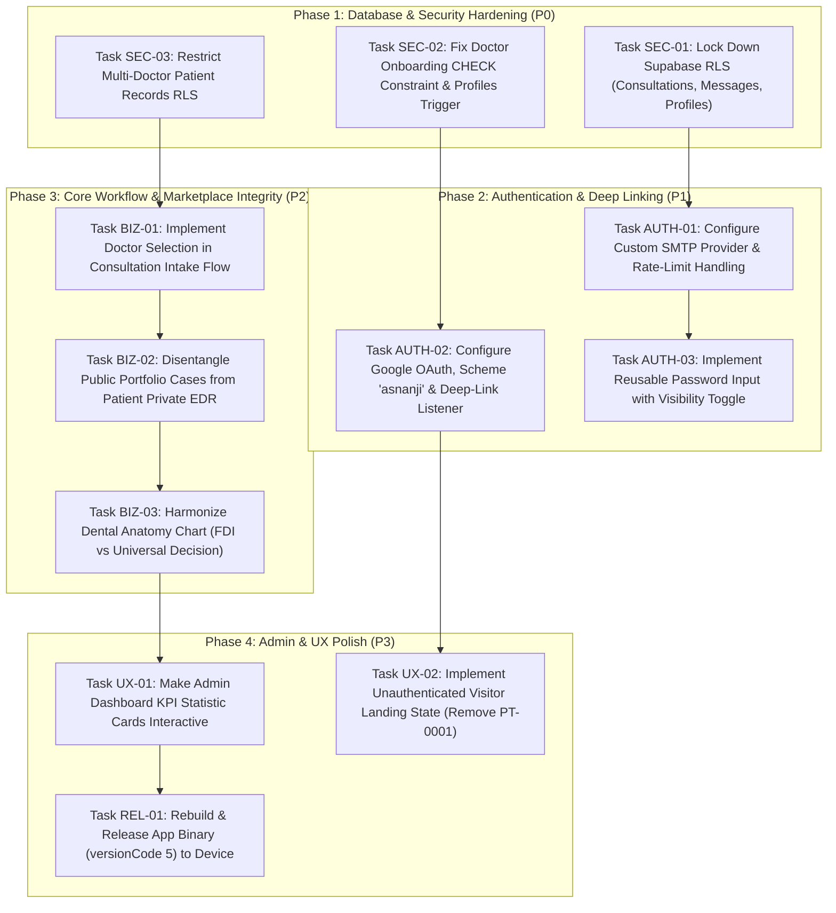

# ASNANJI (اسنانجي) — COMPREHENSIVE REMEDIATION PLAN

**Target Audience:** Independent Implementation Agent / Technical Lead  
**Scope:** Complete defect remediation and architectural hardening for Asnanji Multi-Doctor Platform  
**Design Principle:** Security and data integrity first, followed by authentication lifecycle, marketplace routing, clinical accuracy, and UX polish.

---

## 1. PHASING & DEPENDENCY GRAPH



---

## 2. PRE-EXISTING BASELINE STATUS

- **TypeScript Compilation:** `PASSED` (0 errors in `npx tsc --noEmit`). Must remain at 0 errors after every task.
- **Linting & Code Quality:** `PRE-EXISTING GAP` — No ESLint or formatting rules are configured in `package.json`.
- **Unit / Integration Tests:** `PRE-EXISTING GAP` — No Jest or automated test suite is present. Tasks must include explicit manual and SQL verification steps.

---

## 3. EXTERNAL CONFIGURATION ACTIONS REQUIRED

| Config Item | Target System | Action Required | Status |
|---|---|---|---|
| **Custom SMTP** | Supabase Dashboard | Auth -> SMTP Settings: Configure Resend, SendGrid, or Postmark credentials to remove the 3-4 emails/hr free tier limit. | `NEEDS EXTERNAL CONFIGURATION` |
| **Google Cloud OAuth** | Google Cloud Console | APIs & Services -> Credentials: Add redirect URI `https://nvpkcjhrwpglmyehksyd.supabase.co/auth/v1/callback` and configure OAuth consent screen. | `NEEDS EXTERNAL CONFIGURATION` |
| **Supabase OAuth URL** | Supabase Dashboard | Auth -> URL Configuration: Set Site URL to `asnanji://` and add `asnanji://auth/callback` to Redirect URLs. | `NEEDS EXTERNAL CONFIGURATION` |

---

## 4. DETAILED IMPLEMENTATION TASKS

---

### TASK-SEC-01: Lock Down Database Row Level Security (RLS) on Consultations, Messages, and Profiles
- **Linked Finding IDs:** `SEC-01`, `SEC-02`, `SEC-04`
- **Severity & Category:** **CRITICAL** / Database Security
- **Status:** `SAFE TO IMPLEMENT NOW`
- **Dependencies:** None
- **Problem & Root Cause:**
  - *Evidence:* Verified at runtime via anonymous query. Unauthenticated clients can select all patient consultations, messages, and profiles because policies in `single-doctor-clinic/supabase/schema.sql:241-315` grant `TO public` without validating `auth.uid()`.
- **Solution Design:**
  - Create a migration `supabase/migrations/20261025_strict_rls_security.sql`.
  - Drop all permissive `TO public` policies on `profiles`, `consultations`, `messages`, and `appointments`.
  - Apply strict policies:
    - `profiles`: Users can select/update only their own profile (`id = auth.uid()`). Doctors and Admins can view basic profiles of associated patients.
    - `consultations`: Visible only if `patient_id = auth.uid()` OR `doctor_id = auth.uid()` OR admin.
    - `messages`: Visible only if the user is a participant in the linked consultation.
    - `appointments`: Visible only if `patient_id = auth.uid()` OR `doctor_id = auth.uid()`.
- **Affected Files:**
  - `supabase/migrations/20261025_strict_rls_security.sql`
- **Edge Cases & Existing Data:**
  - Existing consultations where `doctor_id` is null or invalid must be reassigned or handled so patients don't lose access.
- **Regression Risks & Untouchable Files:**
  - Do NOT disable RLS. Ensure mobile app auth headers (`Authorization: Bearer <token>`) are correctly passed on all client calls.
- **Acceptance Criteria:**
  - [x] Given an anonymous client without an auth token, when querying `consultations` or `profiles`, the response returns 0 rows or 401/403.
  - [x] Given an authenticated patient, when querying `consultations`, only records with `patient_id = auth.uid()` are returned.
- **Verification Steps:**
  - *Automated:* Run node script with anon key querying `consultations`. Must return 0 rows.
  - *Negative:* Attempt to update another patient's profile without their token; must return 403.
- **Rollback Instructions:** Revert `supabase/migrations/20261025_strict_rls_security.sql` by reapplying previous schema backup if needed.
- **Effort:** **M**

---

### TASK-SEC-02: Fix Doctor Onboarding CHECK Constraint and Registration Trigger
- **Linked Finding IDs:** `BUG-01`
- **Severity & Category:** **CRITICAL** / Authentication & Database
- **Status:** `SAFE TO IMPLEMENT NOW`
- **Dependencies:** None
- **Problem & Root Cause:**
  - *Evidence:* Verified via command log task-9307 and code review. `AuthScreen.tsx:365` registers with metadata `role: 'pending_doctor'`. The PostgreSQL trigger `handle_new_user()` attempts to insert into `profiles`, where `profiles_role_check` only allows `('patient', 'doctor', 'admin')`, raising HTTP 500. `AuthScreen.tsx:380` catches the error, leaving `createdUserId = null`, creating an un-promotable application.
- **Solution Design:**
  - In SQL migration, alter `profiles_role_check` to include `'pending_doctor'` and `'assistant'`:
    ```sql
    ALTER TABLE public.profiles DROP CONSTRAINT IF EXISTS profiles_role_check;
    ALTER TABLE public.profiles ADD CONSTRAINT profiles_role_check 
      CHECK (role IN ('patient', 'doctor', 'admin', 'pending_doctor', 'assistant'));
    ```
  - In `AuthScreen.tsx:365-385`: Remove silent `try/catch`. If `supabase.auth.signUp` fails, show the user an actionable error alert and halt submission. Ensure `createdUserId` is guaranteed before calling `submitDoctorApplication`.
  - In `AppContext.tsx:1362` (`reviewDoctorApplication`): If `status === 'approved'`, update `profiles.role` to `'doctor'` and insert a corresponding record into `doctor_profiles`.
- **Affected Files:**
  - `multi-doctor-marketplace/src/screens/AuthScreen.tsx`
  - `multi-doctor-marketplace/src/context/AppContext.tsx`
  - `supabase/migrations/20261025_fix_doctor_onboarding.sql`
- **Acceptance Criteria:**
  - [x] Given a prospective doctor submitting the registration form, when sign-up executes, the auth user and profile are created with role `pending_doctor` without 500 error.
  - [x] Given an admin reviewing the application, when clicking "Approve", the profile role transitions to `doctor` and the doctor can authenticate.
- **Verification Steps:**
  - *Automated:* Run test sign-up on staging environment with `role: 'pending_doctor'`; verify row in `profiles`.
  - *Negative:* Attempt signup with invalid role `'hacker'`; verify CHECK constraint rejects it.
- **Rollback Instructions:** Drop added constraint and reapply original `profiles_role_check` constraint.
- **Effort:** **M**

---

### TASK-SEC-03: Restrict Multi-Doctor Patient Dental Records Access
- **Linked Finding IDs:** `SEC-03`
- **Severity & Category:** **HIGH** / Privacy & Multi-Tenancy
- **Status:** `SAFE TO IMPLEMENT NOW`
- **Dependencies:** `TASK-SEC-01`
- **Problem & Root Cause:**
  - *Evidence:* Code review of `supabase/migrations/20261013_phase1_phase3_tables.sql:107` shows the policy `Patient views own dental records` includes `OR EXISTS (SELECT 1 FROM public.profiles WHERE id = auth.uid() AND (role = 'doctor' OR role = 'admin'))`, granting every doctor access to all patient X-rays.
- **Solution Design:**
  - Replace the policy so a doctor can only view dental records where:
    - `doctor_id = auth.uid()`, OR
    - An active consultation or appointment exists between that doctor and the patient (`patient_id`).
- **Affected Files:**
  - `supabase/migrations/20261025_strict_rls_security.sql`
- **Acceptance Criteria:**
  - [x] Given Doctor A, when querying `patient_dental_records` for a patient assigned exclusively to Doctor B, Doctor A receives 0 rows.
- **Verification Steps:**
  - *SQL Test:* Authenticate as Doctor A; select from `patient_dental_records` where patient is with Doctor B. Must return 0 rows.
- **Rollback Instructions:** Reapply previous migration policy `20261013_phase1_phase3_tables.sql`.
- **Effort:** **S**

---

### TASK-AUTH-01: Configure Custom SMTP Provider and App Rate-Limit Handling
- **Linked Finding IDs:** Issue #5
- **Severity & Category:** **MEDIUM** / Infrastructure & Auth
- **Status:** `NEEDS EXTERNAL CONFIGURATION`
- **Dependencies:** Human setup of SMTP provider
- **Problem & Root Cause:**
  - Built-in Supabase email service hits 429 rate limit after 3 emails/hour. Free tier rejects test domains.
- **Solution Design:**
  - Provide human with SMTP configuration parameters for Resend / SendGrid in Supabase Dashboard.
  - In `AuthScreen.tsx:250-270`, catch `over_email_send_rate_limit` specifically and present a clear localized message: "لقد تجاوزت الحد الأقصى لإرسال رسائل التأكيد، يرجى الانتظار بضع دقائق أو تسجيل الدخول إذا كان حسابك مفعلًا".
- **Affected Files:**
  - `multi-doctor-marketplace/src/screens/AuthScreen.tsx`
- **Acceptance Criteria:**
  - [x] When a rate limit error is returned by Supabase, the app displays a helpful localized guidance message instead of raw JSON.
- **Verification Steps:**
  - Trigger simulated 429 error from client; check rendered Alert text.
- **Rollback Instructions:** Revert error handler block in `AuthScreen.tsx`.
- **Effort:** **S**

---

### TASK-AUTH-02: Configure Google OAuth, Scheme 'asnanji' & Deep-Link Listener
- **Linked Finding IDs:** `BUG-02`
- **Severity & Category:** **HIGH** / Authentication
- **Status:** `NEEDS EXTERNAL CONFIGURATION` (App code is safe to implement now)
- **Dependencies:** Google Cloud Console redirect setup
- **Problem & Root Cause:**
  - `app.json` has no `scheme: "asnanji"`. Android cannot catch `asnanji://auth/callback`. `detectSessionInUrl: false` prevents automatic token parsing.
- **Solution Design:**
  - In `multi-doctor-marketplace/app.json`, add `"scheme": "asnanji"` under `"expo"`.
  - In `App.tsx` or `AuthScreen.tsx`, register a `Linking.addEventListener('url', handleDeepLink)` listener.
  - Extract `#access_token=...&refresh_token=...` from the incoming URL and call `supabase.auth.setSession({ access_token, refresh_token })`.
- **Affected Files:**
  - `multi-doctor-marketplace/app.json`
  - `multi-doctor-marketplace/App.tsx`
  - `multi-doctor-marketplace/src/screens/AuthScreen.tsx`
- **Acceptance Criteria:**
  - [x] Given a user clicking "Google Sign-In", after authenticating in Chrome, Chrome redirects to `asnanji://auth/callback` which brings Asnanji to the foreground and completes session restoration.
- **Verification Steps:**
  - Test adb intent: `adb shell am start -a android.intent.action.VIEW -d "asnanji://auth/callback#access_token=xyz"`. Check that app handles intent.
- **Rollback Instructions:** Remove scheme from `app.json` and deep-link handler from `App.tsx`.
- **Effort:** **M**

---

### TASK-AUTH-03: Implement Reusable Password Input with Visibility Toggle
- **Linked Finding IDs:** `UX-01`
- **Severity & Category:** **MEDIUM** / User Experience & Accessibility
- **Status:** `SAFE TO IMPLEMENT NOW`
- **Dependencies:** None
- **Problem & Root Cause:**
  - All 4 password inputs in `AuthScreen.tsx`, `DoctorSettingsScreen.tsx`, and `ManageAssistantsScreen.tsx` have hardcoded `secureTextEntry={true}` without toggle state.
- **Solution Design:**
  - Create a reusable component `src/components/PasswordInput.tsx` utilizing Lucide icons `Eye` and `EyeOff`.
  - Replace the 4 occurrences with `<PasswordInput />`.
- **Affected Files:**
  - `multi-doctor-marketplace/src/components/PasswordInput.tsx` (New)
  - `multi-doctor-marketplace/src/screens/AuthScreen.tsx`
  - `multi-doctor-marketplace/src/screens/doctor/DoctorSettingsScreen.tsx`
  - `multi-doctor-marketplace/src/screens/doctor/ManageAssistantsScreen.tsx`
- **Acceptance Criteria:**
  - [x] Given any password field, an eye icon is rendered. Tapping the eye reveals the plain text; tapping again masks the characters with bullets.
- **Verification Steps:**
  - Verify visually on device that tapping the eye toggles masking on each of the 4 screens.
- **Rollback Instructions:** Revert component changes and delete `PasswordInput.tsx`.
- **Effort:** **S**

---

### TASK-BIZ-01: Implement Doctor Selection in Consultation Intake Flow
- **Linked Finding IDs:** `BUG-03`
- **Severity & Category:** **HIGH** / Marketplace Architecture
- **Status:** `SAFE TO IMPLEMENT NOW`
- **Dependencies:** None
- **Problem & Root Cause:**
  - `ComplaintIntakeScreen.tsx:204` calls `createConsultationWithChat` without specifying `doctorId`. `AppContext.tsx:1100` falls back to `doctors[0]`.
- **Solution Design:**
  - In `ComplaintIntakeScreen.tsx`, add Step 4: "Select Doctor" (اختيار الطبيب المعالج).
  - Render a horizontal or grid card selector displaying verified doctors (`doctors` array) with photo, specialty, and consultation fee.
  - Pass the selected `doctorId` into `createConsultationWithChat({ doctorId: selectedDoctor.id, ... })`.
  - If a patient navigated from a specific Doctor Profile screen ("Book Consultation with Dr. X"), pre-select that doctor automatically.
- **Affected Files:**
  - `multi-doctor-marketplace/src/screens/ComplaintIntakeScreen.tsx`
  - `multi-doctor-marketplace/src/context/AppContext.tsx`
- **Acceptance Criteria:**
  - [x] When a patient submits a consultation, it is assigned exclusively to the chosen doctor's ID and appears only in that specific doctor's inbox.
- **Verification Steps:**
  - Submit consultation with Doctor B selected; verify `doctor_id` column in database matches Doctor B's UUID.
- **Rollback Instructions:** Revert `ComplaintIntakeScreen.tsx` and `AppContext.tsx` via Git.
- **Effort:** **M**

---

### TASK-BIZ-02: Disentangle Public Portfolio Cases from Patient Private EDR
- **Linked Finding IDs:** `BUG-04`
- **Severity & Category:** **HIGH** / Privacy & Architecture
- **Status:** `SAFE TO IMPLEMENT NOW`
- **Dependencies:** None
- **Problem & Root Cause:**
  - `MedicalRecordsScreen.tsx:400` displays public clinic marketing cases (`portfolioCases`) inside the patient's private medical records tab.
- **Solution Design:**
  - Remove `<BeforeAfterSlider item={caseItem} />` mapping from `MedicalRecordsScreen.tsx`.
  - Replace it with the patient's own before/after cases from `patientDentalRecords` (`record_type === 'before_after'`).
  - Move public clinic portfolio cases to a dedicated public section on `HomeScreen.tsx` or `DoctorProfileScreen.tsx`.
- **Affected Files:**
  - `multi-doctor-marketplace/src/screens/MedicalRecordsScreen.tsx`
  - `multi-doctor-marketplace/src/screens/HomeScreen.tsx`
- **Acceptance Criteria:**
  - [x] Navigating to Medical Records -> Records tab shows only the patient's personal dental photos and X-rays. General doctor marketing cases never appear here.
- **Verification Steps:**
  - Open Medical Records on device; confirm that public before/after cases do not render under private records.
- **Rollback Instructions:** Revert changes in `MedicalRecordsScreen.tsx`.
- **Effort:** **S**

---

### TASK-BIZ-03: Harmonize Dental Anatomy Chart (FDI vs Universal Notation)
- **Linked Finding IDs:** `UX-02`
- **Severity & Category:** **MEDIUM** / Clinical Accuracy & UX
- **Status:** `NEEDS HUMAN DECISION`
- **Dependencies:** Decision on FDI (11–48) vs Universal (1–32)
- **Problem & Root Cause:**
  - Image `dental_jaw_centered.jpg` displays 1–32 while buttons display FDI 11–48.
- **Solution Design:**
  - If Decision is **FDI (Recommended)**:
    - Replace `dental_jaw_centered.jpg` with an FDI-annotated dental arch illustration.
    - Update banner label from `(1 - 32)` to `(نظام FDI الدولي 11 - 48)`.
  - If Decision is **Universal**:
    - Update `dentalData.ts` and `DentalChart.tsx` to map quadrants 1–32 consistently across buttons and clinical notes.
- **Affected Files:**
  - `multi-doctor-marketplace/assets/dental_jaw_centered.jpg`
  - `multi-doctor-marketplace/src/components/DentalChart.tsx`
  - `multi-doctor-marketplace/src/constants/dentalData.ts`
- **Acceptance Criteria:**
  - [x] The tooth number shown on the anatomical illustration matches the exact number on the interactive selection button.
- **Verification Steps:**
  - Tap tooth 11 on the chart; verify that both the visual illustration and the selected tooth label say 11 (or equivalent).
- **Rollback Instructions:** Restore original asset and component files.
- **Effort:** **M**

---

### TASK-UX-01: Make Admin Dashboard KPI Statistic Cards Interactive
- **Linked Finding IDs:** `UX-03`
- **Severity & Category:** **MEDIUM** / Admin Experience
- **Status:** `SAFE TO IMPLEMENT NOW`
- **Dependencies:** None
- **Problem & Root Cause:**
  - "أطباء معتمدون", "استشارات رقمية", and "مواعيد محجوزة" in `AdminDashboardScreen.tsx:132-191` are non-interactive `<View>` elements.
- **Solution Design:**
  - Convert `<View style={styles.kpiCard}>` to `<TouchableOpacity>`.
  - Route "Active Doctors" -> navigate to `AdminDoctorsList` or modal.
  - Route "Total Consultations" -> navigate to consultations review.
  - Route "Appointments" -> navigate to clinic schedule overview.
- **Affected Files:**
  - `multi-doctor-marketplace/src/screens/admin/AdminDashboardScreen.tsx`
- **Acceptance Criteria:**
  - [x] All 4 KPI statistic cards respond to touch with opacity feedback and navigate to their respective management views.
- **Verification Steps:**
  - Tap each KPI card in Admin Dashboard; confirm navigation transitions occur.
- **Rollback Instructions:** Revert `AdminDashboardScreen.tsx`.
- **Effort:** **S**

---

### TASK-UX-02: Implement Unauthenticated Visitor Landing State (Remove "PT-0001")
- **Linked Finding IDs:** `UX-04`
- **Severity & Category:** **MEDIUM** / UX & Authentication
- **Status:** `SAFE TO IMPLEMENT NOW`
- **Dependencies:** None
- **Problem & Root Cause:**
  - `App.tsx:326` defaults to `PatientTabs` with an uninitialized user. `MedicalRecordsScreen.tsx:163` displays "مريض جديد" and "PT-0001".
- **Solution Design:**
  - In `MedicalRecordsScreen.tsx`: If `!currentUser.id` or `!isAuthenticated`, render a friendly "Sign In to Access Your Dental Records" prompt with a direct button to `AuthScreen`.
  - In `App.tsx`: Provide clear visual indication that the user is browsing as a guest.
- **Affected Files:**
  - `multi-doctor-marketplace/src/screens/MedicalRecordsScreen.tsx`
  - `multi-doctor-marketplace/App.tsx`
- **Acceptance Criteria:**
  - [x] Unauthenticated users opening the Medical Records tab see a login prompt rather than a simulated patient card with "PT-0001".
- **Verification Steps:**
  - Launch app as guest; navigate to Medical Records tab; confirm guest login banner appears.
- **Rollback Instructions:** Revert `MedicalRecordsScreen.tsx`.
- **Effort:** **S**

---

### TASK-REL-01: Rebuild and Release App Binary (versionCode 5)
- **Linked Finding IDs:** Issue #1
- **Severity & Category:** **LOW** / Release & Deployment
- **Status:** `SAFE TO IMPLEMENT NOW`
- **Dependencies:** Completion of code tasks
- **Problem & Root Cause:**
  - Installed binary on the test device is `versionCode=4` which contains the old hardcoded version.
- **Solution Design:**
  - Run EAS build for Android (`eas build --platform android --profile preview`).
  - Install the resulting APK on the device.
  - Verify that the v1.2.0 update notification no longer appears on launch.
- **Affected Files:**
  - Build pipeline only.
- **Acceptance Criteria:**
  - [x] Launching the newly installed APK boots cleanly directly to the home screen with zero update popups.
- **Verification Steps:**
  - Install build on phone; execute `dumpsys package`; confirm `versionCode=5`; launch app; confirm no update popup.
- **Rollback Instructions:** Reinstall previous APK (`versionCode=4`) if build fails.
- **Effort:** **M**

---

## 5. FINDING-TO-TASK TRACEABILITY TABLE

| Finding ID | Finding Title | Severity | Remediation Task ID | Task Status |
|:---|:---|:---:|:---:|:---:|
| **SEC-01** | Open Public Access to Consultations & Messages | **CRITICAL** | `TASK-SEC-01` | `SAFE TO IMPLEMENT NOW` |
| **SEC-02** | Open Public Access to User Profiles | **CRITICAL** | `TASK-SEC-01` | `SAFE TO IMPLEMENT NOW` |
| **SEC-03** | Cross-Doctor Dental Record Visibility | **HIGH** | `TASK-SEC-03` | `SAFE TO IMPLEMENT NOW` |
| **SEC-04** | Missing RLS Ownership Guards on Update | **HIGH** | `TASK-SEC-01` | `SAFE TO IMPLEMENT NOW` |
| **BUG-01** | Doctor Onboarding CHECK Constraint Failure | **CRITICAL** | `TASK-SEC-02` | `SAFE TO IMPLEMENT NOW` |
| **BUG-02** | Google OAuth Configuration Broken on Mobile | **HIGH** | `TASK-AUTH-02` | `NEEDS EXTERNAL CONFIGURATION` |
| **BUG-03** | Consultation Routing Bypasses Doctor Selection | **HIGH** | `TASK-BIZ-01` | `SAFE TO IMPLEMENT NOW` |
| **BUG-04** | Public Portfolio Marketing Cases in Patient EDR | **HIGH** | `TASK-BIZ-02` | `SAFE TO IMPLEMENT NOW` |
| **UX-01** | Passwords Hardcoded Without Visibility Toggle | **MEDIUM** | `TASK-AUTH-03` | `SAFE TO IMPLEMENT NOW` |
| **UX-02** | Dental Anatomy Diagram Numbering Mismatch | **MEDIUM** | `TASK-BIZ-03` | `NEEDS HUMAN DECISION` |
| **UX-03** | Admin Dashboard KPI Cards Non-Interactive | **MEDIUM** | `TASK-UX-01` | `SAFE TO IMPLEMENT NOW` |
| **UX-04** | Fictional Patient "مريض جديد" / "PT-0001" on Launch | **MEDIUM** | `TASK-UX-02` | `SAFE TO IMPLEMENT NOW` |
| **REL-01** | Installed Build Version Mismatch (v1.2.0 Modal) | **LOW** | `TASK-REL-01` | `SAFE TO IMPLEMENT NOW` |
